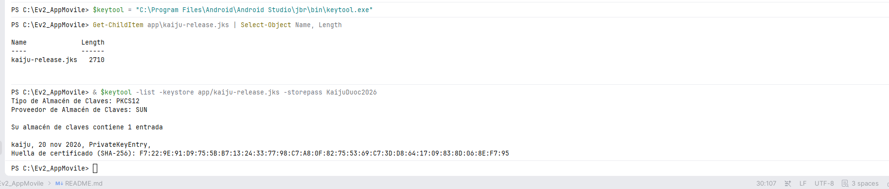
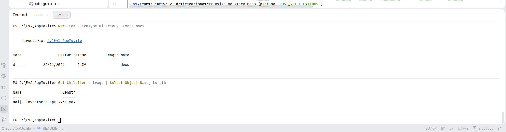
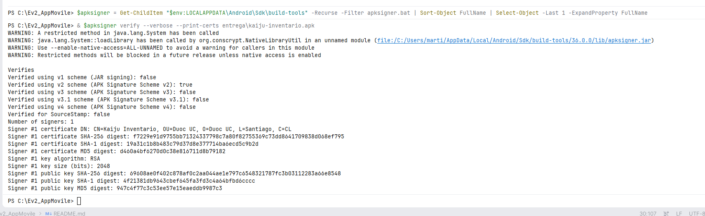

# Kaiju Inventario

Aplicación Android para la **gestión y trazabilidad de inventario** de la empresa ficticia **Kaiju**.
Proyecto académico (MVP) con **datos ficticios**: no se usan datos ni credenciales reales.

- **Asignatura:** DSY1105 Desarrollo de Aplicaciones Móviles, sección DSY1105-005D
- **Institución:** Duoc UC, CITT San Bernardo
- **Grupo:** 8
- **Paquete:** `cl.duoc.kaiju`

## 1. Nombre del proyecto

**Kaiju Inventario**

Repositorios del proyecto:

| Repositorio | Contenido |
| [kaiju-inventario](https://github.com/MartinCC77/kaiju-inventario) | App móvil (este repositorio) |
| [usuarios-api](https://github.com/MartinCC77/usuarios-api) | Microservicio de usuarios y login (Spring Boot) |

## 2. Integrantes

| Integrante
| Martin Cortes 
| Christian Montecinos 
| Gabriel Fuentes 

Los commits de cada integrante se pueden ver en la pestaña **Commits** de GitHub o con `git shortlog -sn`.

**Planificación del equipo (Trello):** https://trello.com/invite/b/6b03691635d3801f38de7de7/ATTI3a1f8e6c111b2879966f20b47fb3c95b45CA7F2F/kaiju-inventario-g8

## 3. Funcionalidades

- **Login conectado al microservicio:** el inicio de sesión valida correo y contraseña contra el backend (`/api/auth/login`). Muestra errores de credenciales y de conexión sin cerrar la app.
- **Gestión de usuarios (CRUD completo):** listar, crear, editar y eliminar usuarios desde la pestaña *Usuarios*, con validaciones y confirmación antes de eliminar.
- **Productos:** formulario validado (código único, precio mayor a 0, stock y mínimo enteros no negativos), lista con aviso de stock bajo y eliminación.
- **Movimientos:** entradas, salidas y ajustes. La salida no puede dejar el stock negativo y el ajuste exige un motivo. Historial con trazabilidad.
- **Ventas:** descuenta stock, guarda la venta y registra una salida con motivo "Venta", todo en una transacción de Room.
- **Resumen:** total vendido, productos más y menos vendidos y ventas por categoría, con barras animadas.
- **API externa:** la pestaña *Resumen* muestra el dólar, el euro, la UF y la UTM (mindicador.cl) y convierte el total vendido a dólares. Si el servicio externo falla, solo esa tarjeta muestra un aviso.
- **Recurso nativo 1, cámara:** escáner de códigos QR y de barras con CameraX y ML Kit. Pide el permiso en tiempo de ejecución y no se cierra si se rechaza.
- **Recurso nativo 2, notificaciones:** aviso de stock bajo (permiso `POST_NOTIFICATIONS`).
- **Animaciones:** cambio entre pestañas, barras animadas, sacudida de campos con error, pulso del aviso de stock bajo y animación de listas.

### Arquitectura

Patrón **MVVM con Repository**. Cada ViewModel recibe sus dependencias por el constructor, lo que permite probarlos con repositories falsos.

```
app/src/main/java/cl/duoc/kaiju/
├── data/
│   ├── local/        Room: AppDatabase, dao, entity
│   └── remote/       Retrofit: ApiService, RetrofitInstance, API externa y modelos
├── model/            Estados de pantalla y resultados
├── repository/       Acceso a datos (Room y red)
├── ui/               screen, components, navigation, theme
├── utils/            Validaciones y notificaciones
└── viewmodel/        Lógica de cada pantalla (StateFlow)
```

### Tecnología

| Componente | Versión |
|---|---|
| Kotlin / Jetpack Compose (Material 3) | 2.4.21 / BOM 2026.09.00 |
| Android Gradle Plugin / Gradle | 9.4.1 / 9.6.0 |
| minSdk / compileSdk | 30 / 37 |
| Room (SQLite) | 2.8.5 |
| Retrofit + Gson | 3.0.0 |
| CameraX / ML Kit Barcode | 1.4.1 / 17.3.0 |
| Pruebas: Kotest / MockK / coroutines-test | 6.2.6 / 1.14.11 / 1.11.0 |

## 4. Endpoints utilizados

### Microservicio propio: `usuarios-api` (Spring Boot + MySQL)

Servidor desplegado en AWS EC2. **URL base:** `http://52.45.85.64:8080`

| Método | Endpoint | Descripción | Respuestas |
|---|---|---|---|
| POST | `/api/auth/login` | Inicia sesión. Cuerpo: `{"correo": "...", "contrasena": "..."}` | 200 con el usuario, 401 credenciales incorrectas, 400 datos vacíos |
| GET | `/api/usuarios` | Lista todos los usuarios | 200 |
| GET | `/api/usuarios/{id}` | Obtiene un usuario | 200, 404 |
| POST | `/api/usuarios` | Crea un usuario. Cuerpo: `nombre`, `correo`, `contrasena`, `rol` | 201, 400, 409 correo repetido |
| PUT | `/api/usuarios/{id}` | Modifica un usuario (contraseña y rol opcionales) | 200, 400, 404, 409 |
| DELETE | `/api/usuarios/{id}` | Elimina un usuario | 204, 404 |

Las contraseñas se guardan cifradas con BCrypt y nunca se devuelven en las respuestas. Los errores se responden como `{"mensaje": "..."}`.

### API externa: mindicador.cl

| Método | Endpoint | Uso en la app |
|---|---|---|
| GET | `https://mindicador.cl/api` | Dólar, euro, UF y UTM en la pestaña *Resumen* |

## 5. Pasos para ejecutar

### Requisitos

- Android Studio reciente (compatible con Android Gradle Plugin 9.4)
- Dispositivo o emulador con **Android 11 o superior** (API 30)
- Conexión a internet (login y API externa)

### Ejecución

1. Clonar el repositorio:
   ```
   git clone https://github.com/MartinCC77/kaiju-inventario.git
   ```
2. Abrir la carpeta en Android Studio y esperar a que Gradle sincronice.
3. Seleccionar un dispositivo y presionar **Run**.
4. Iniciar sesión con el usuario de prueba (ficticio): **`admin@kaiju.cl`** / **`kaiju123`**.

El backend ya está desplegado en AWS, por lo que no hace falta ejecutarlo para probar la app. Si se quiere usar un backend local, la instrucción está en el README de [usuarios-api](https://github.com/MartinCC77/usuarios-api) y hay que cambiar la constante `BASE_URL` de `data/remote/RetrofitInstance.kt` (en el emulador, `http://10.0.2.2:8080/`).

### Instalar el APK firmado

```
adb install entrega/kaiju-inventario.apk
```

### Pruebas unitarias

```
./gradlew testDebugUnitTest
./gradlew createDebugUnitTestCoverageReport
```

El informe de cobertura queda en `app/build/reports/coverage/test/debug/index.html`.

Cobertura de la lógica de negocio (instrucciones cubiertas por las pruebas unitarias):

| Paquete | Cobertura |
|---|---|
| `viewmodel` | 93% |
| `repository` | 81% |
| `model` | 97% |

El total del proyecto es menor porque incluye las pantallas de Compose y el código que genera Room, que no son lógica de negocio.



## 6. APK firmado y llave (.jks)

| Elemento | Ubicación |
|---|---|
| APK firmado | `entrega/kaiju-inventario.apk` |
| Llave de firma | `app/kaiju-release.jks` (alias `kaiju`) |
| Configuración de la firma | bloque `signingConfigs` de `app/build.gradle.kts` |

La llave es de uso **exclusivamente académico**: se publica en el repositorio solo porque la evaluación lo exige. No debe usarse para una aplicación real.

Verificación de la firma:

```
apksigner verify --verbose --print-certs entrega/kaiju-inventario.apk
```





## Limitaciones conocidas y mejoras pendientes

- El backend no usa token (JWT): los endpoints de usuarios no exigen sesión.
- La comunicación es por `http`; para producción debería usarse `https`.
- La pestaña de usuarios está visible para cualquier usuario, sin restringir por rol.
- La optimización R8 del APK de release está desactivada porque provocaba un cierre al abrir la app (`IllegalAccessError`).
- No hay edición de productos ni diseño especial para tabletas.
- La sesión no se guarda al cerrar la app.
